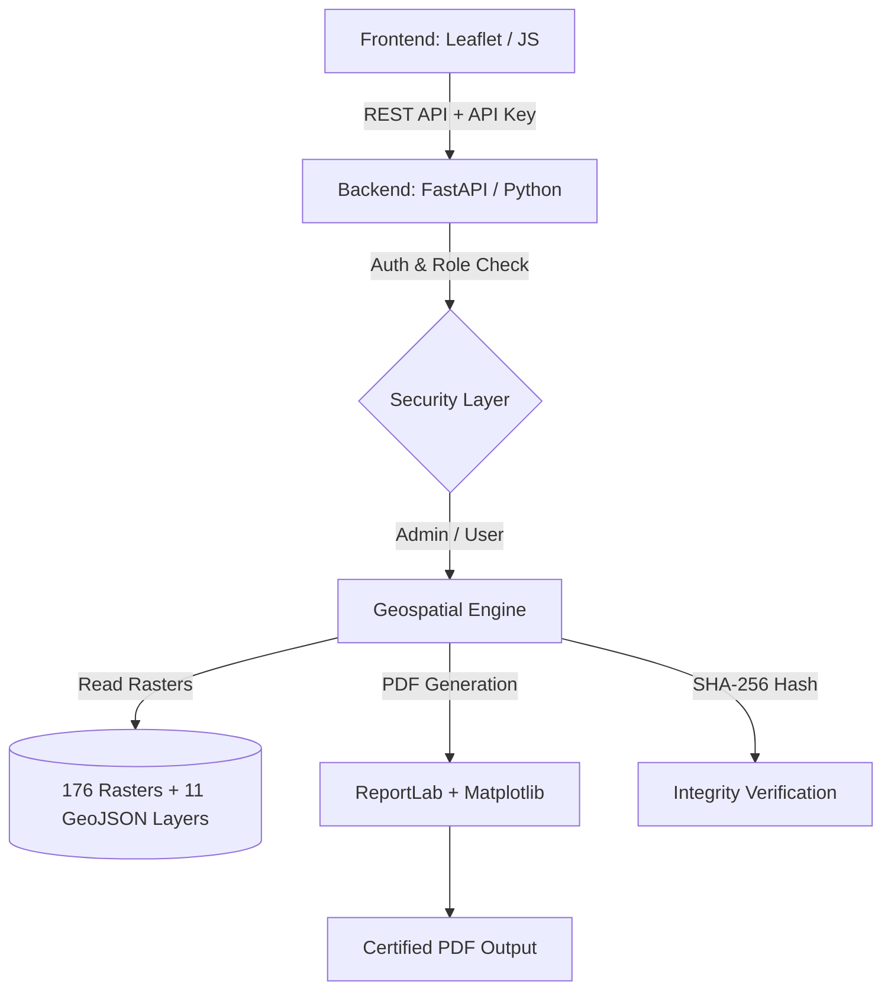

# 🛡️ NdjelTrust — Full-Stack Geospatial Platform

> **Note on source code:** *The full backend and frontend source code is kept private to comply with institutional data security protocols and to protect the intellectual property of the algorithms used. This repository serves as a technical showcase of the architecture, the methodology, and the results. A complete walkthrough can be provided upon request during an interview.*

## 📖 Executive Summary

NdjelTrust is a full-stack geospatial platform designed to automate the generation of **Surface Measurement Certificates (AMS)** for national institutions. It transforms raw GPS coordinates into certified, verifiable PDF documents in **less than 2 seconds**, a process that previously took hours of manual work.

The platform leverages a repository of **176 indexed rasters** (GeoTIFF/IMG) and **11 vector layers**, and uses a modern, 100% open-source stack.

## 🏗️ Architecture & Tech Stack

The system is built on a modular, secure architecture:

### 🔧 Core Technologies

- **Backend:** Python 3.14, FastAPI, Uvicorn
- **Geospatial processing:** Rasterio (raster reading), PyProj (UTM 32N/33N reprojection), Shapely (geometries)
- **Document generation:** ReportLab, Matplotlib (dynamic mapping), QRCode
- **Security:** API key authentication, Role-Based Access Control (Admin/User), SHA-256 hashing for document integrity, CORS protection
- **Frontend:** HTML5, Vanilla JS, Leaflet.js, CSS3

## ⚡ Key Features

- **Instant generation:** Bypasses manual GIS software processing, generating official PDFs in ~2 seconds.
- **Smart raster selection:** Automatically detects the UTM zone and selects the correct background map among 176 indexed rasters.
- **Cryptographic verification:** Every generated PDF is stamped with a unique SHA-256 hash and a QR code for instant authenticity checks.
- **Role-based access:** Differentiated UI and API endpoints for Administrators (full access) and Users (generation only).

## 📊 Impact & Metrics

- **Time saved:** 99.9% reduction in document generation time (from hours to 2 seconds).
- **Cost:** 0 FCFA in software licenses (100% open source).
- **Reliability:** Standardized output, eliminating human errors in legal descriptions and surface calculations.

## 👨‍💻 Author

**Thierry NDJEL DAN**
Full-Stack GIS & Data Engineer

[LinkedIn](https://www.linkedin.com/in/VOTRE-PROFIL) · [Portfolio](https://VOTRE-PORTFOLIO)
